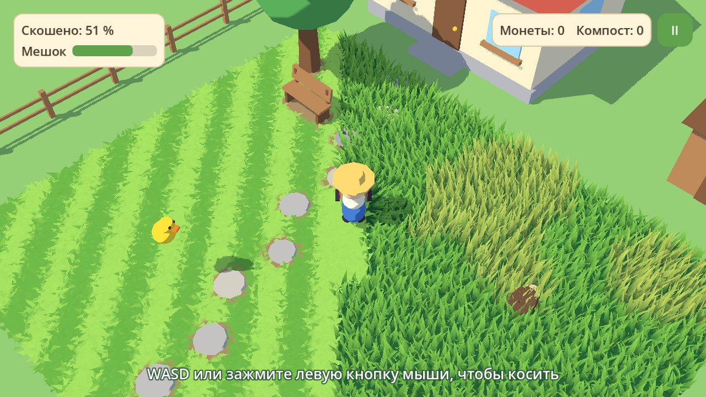
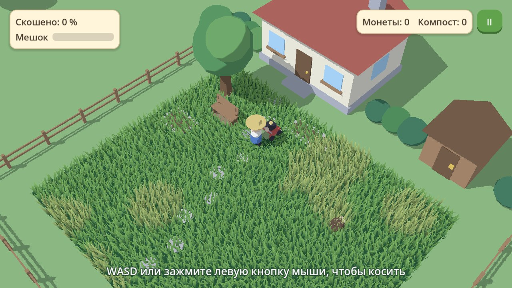
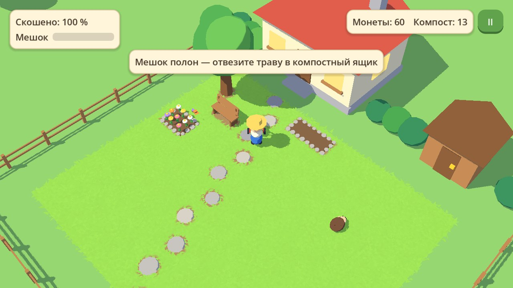

# Cozy-Game

Уютная игра про покос травы: выкашиваешь заросшую деревушку участок за участком и находишь то, что прячется в траве. Полное описание — в [GDD.md](GDD.md).



## Состояние

Готов этап **M1 — первый участок целиком**. Двор своего домика проходится от начала до конца:

- косилка режет траву и оставляет полосы, высокая трава замедляет;
- мешок наполняется, полный мешок останавливает нож, траву высыпают в компостный ящик у калитки;
- под травой прячутся каменная дорожка, скамейка и три находки;
- в траве сидит ёжик: косилка в него упирается, его нужно перенести;
- под травой находятся две клумбы: за компост в них сажают цветы, над цветами летают бабочки;
- с 90 % остатки травы подсвечивают светлячки, на 95 % участок засчитывается (облёт камеры, конфетти, награда, штампы, в доме загораются окна);
- по мере покоса двор оживает: картинка становится ярче и теплее, чаще поют птицы;
- прогресс сохраняется сам: после компоста, находок, посадки цветов, завершения участка и при закрытии игры.

| Заросший двор | Выкошенный двор |
|---|---|
|  |  |

Модели временные, собраны из примитивов. Звуки тоже временные, синтезированные скриптом; музыки пока нет.

## Запуск

1. Установите [Godot 4.8 beta 1](https://godotengine.org/download/archive/4.8-beta1/) (стандартная версия, не .NET).
2. Откройте в нём `project.godot`.
3. Нажмите F5.

## Управление

| Действие | Клавиатура и мышь | Геймпад | Тачскрин |
|---|---|---|---|
| Движение | WASD / стрелки или удержание левой кнопки мыши | Левый стик | Коснуться экрана и тянуть |
| Действие (высыпать траву, перенести ёжика, посадить цветы) | E / пробел или кнопка на экране | A | Кнопка справа внизу |
| Масштаб | Колесо мыши | Бамперы | Щипок двумя пальцами |
| Пауза | Esc | Start | Кнопка справа вверху |

В меню паузы можно выключить звук и начать заново (стирает прогресс).

## Структура

```
scenes/    yard.tscn (участок «Двор», главная сцена), player.tscn, hud.tscn
scripts/   логика на GDScript
shaders/   трава, земля, мультяшный свет
assets/    звуки
tools/     вспомогательные скрипты (генератор временных звуков)
tests/     автопроверки
docs/      картинки для документации (Godot эту папку не импортирует)
```

Главное в `scripts/`:

| Файл | Что делает |
|---|---|
| `game_state.gd` | Автозагрузка `GameState`: монеты, компост, мешок, флаги, сохранение |
| `mow_field.gd` | Поле травы и маска покоса |
| `plot.gd` | Участок: завершение, награда, штампы, светлячки |
| `player.gd` | Персонаж с косилкой, ввод, взаимодействие |
| `interactable.gd` | Основа для объектов с контекстной кнопкой (`compost_bin.gd`, `animal.gd`, `flower_bed.gd`) |
| `find_item.gd` | Находка в траве |
| `flower_bed.gd`, `butterfly.gd` | Клумба, в которую сажают цветы за компост, и бабочки над ней |
| `sfx.gd` | Автозагрузка `Sfx`: звуки и вибрация |
| `juice.gd` | Эффекты отклика: подпрыгивания интерфейса, всплывающий текст, искры, конфетти |
| `plot_prop.gd`, `stepping_stones.gd`, `plot_surroundings.gd` | Дом, сарай, скамейка, дерево, дорожка, забор |
| `placeholder.gd` | Временные модели из примитивов |

Участок собирается в редакторе из этих узлов: их можно двигать, копировать и настраивать в инспекторе. Трава сама обходит объекты и прячет находки.

## Проверки

```bash
godot --headless --path . --fixed-fps 60 --script tests/input.gd
```

```bash
godot --headless --path . --fixed-fps 60 --script tests/plot_cycle.gd
```

Оба теста стирают сохранение игры.
