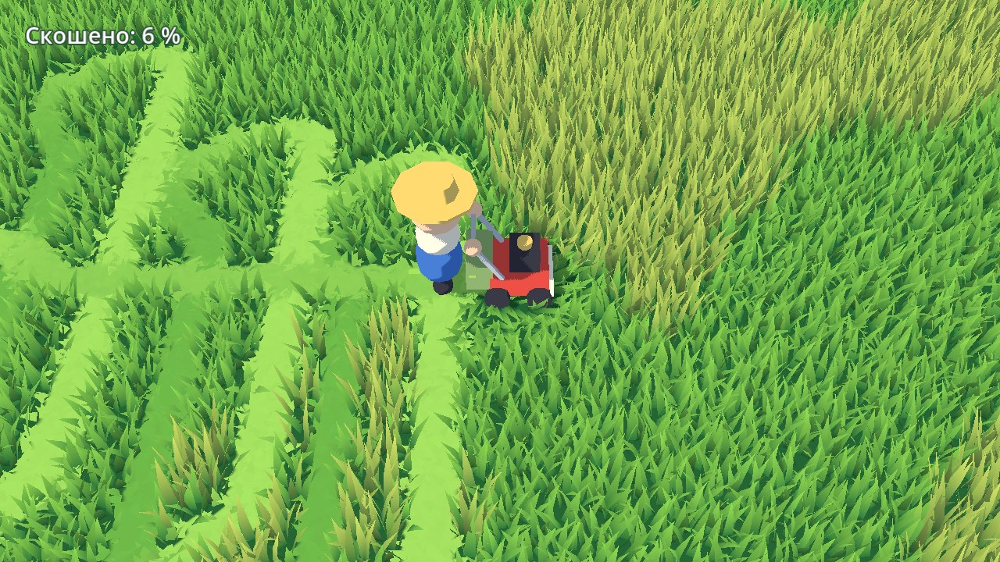

# Cozy-Game

Уютная игра про покос травы: выкашиваешь заросшую деревушку участок за участком и находишь то, что прячется в траве. Полное описание — в [GDD.md](GDD.md).



## Состояние

Готов этап **M0 — прототип покоса**: тестовая поляна, косилка, срезаемая трава с полосами, управление с клавиатуры, мыши, геймпада и тачскрина. Модели временные, собраны из примитивов.

## Запуск

1. Установите [Godot 4.8 beta 1](https://godotengine.org/download/archive/4.8-beta1/) (стандартная версия, не .NET).
2. Откройте в нём `project.godot`.
3. Нажмите F5.

## Управление

| Действие | Клавиатура и мышь | Геймпад | Тачскрин |
|---|---|---|---|
| Движение | WASD / стрелки или удержание левой кнопки мыши | Левый стик | Коснуться экрана и тянуть |
| Масштаб | Колесо мыши | Бамперы | Щипок двумя пальцами |

Косилка режет сама, пока едет. Проход «от камеры» оставляет светлую полосу, «к камере» — тёмную.

## Структура

```
scenes/    сцены: main.tscn (тестовая поляна), player.tscn
scripts/   логика на GDScript
shaders/   трава, земля, мультяшный свет
docs/      картинки для документации (Godot эту папку не импортирует)
```

Главные настройки прототипа — в инспекторе узла `MowField` (размер поляны, плотность травы, доля высокой травы) и узла `Player` (скорость, ширина ножа).
