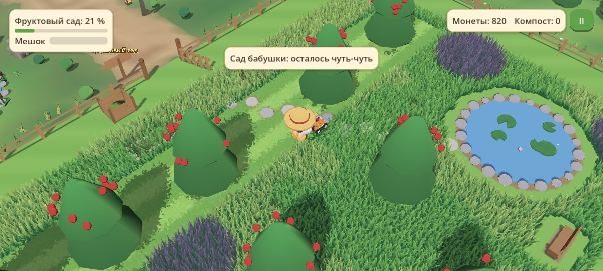
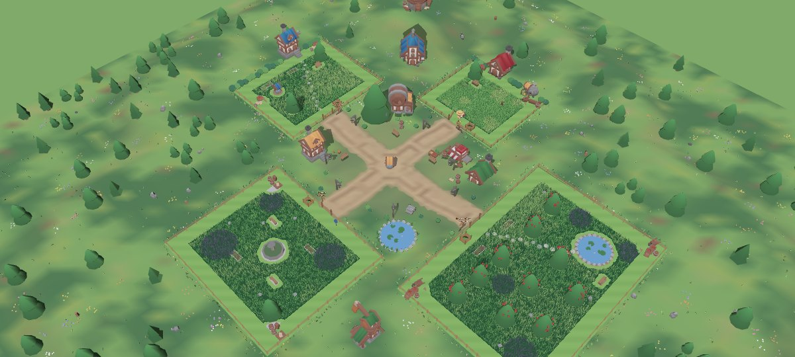
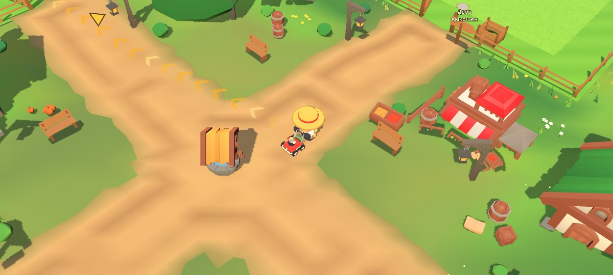
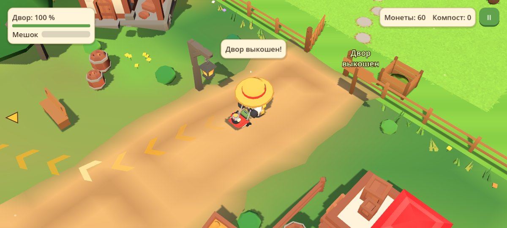
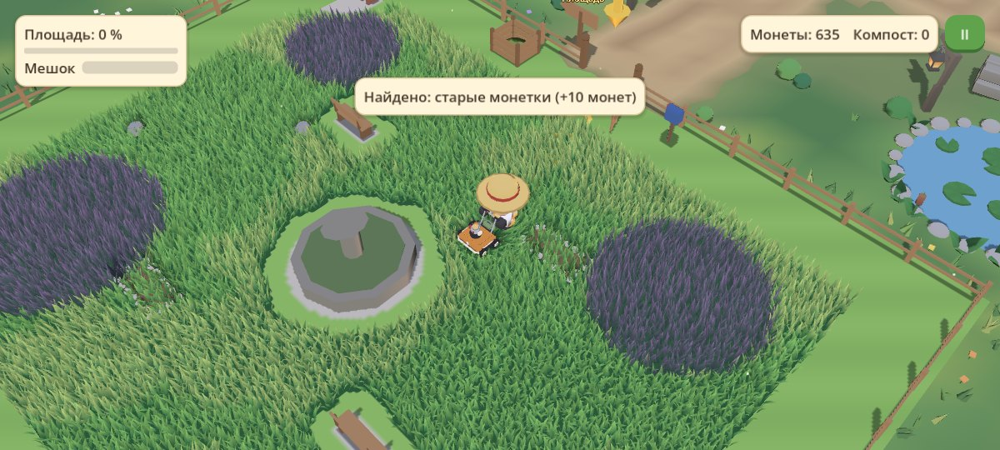
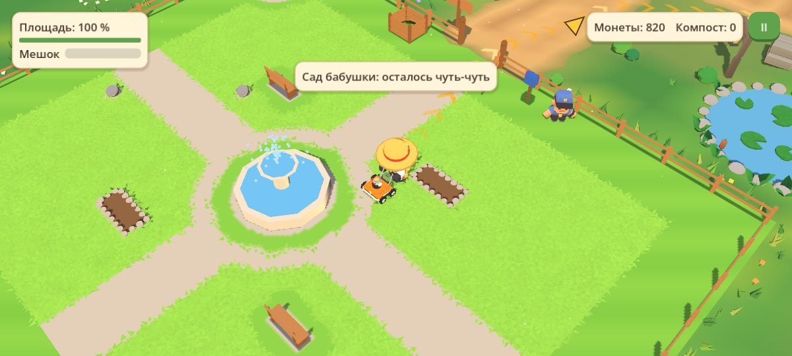
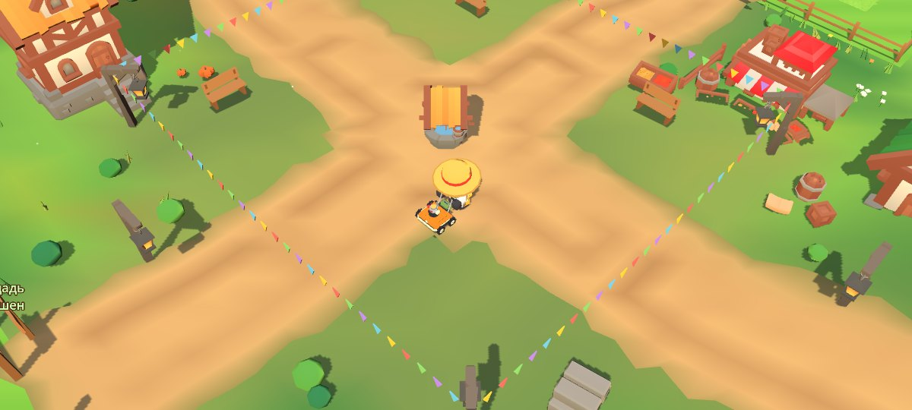
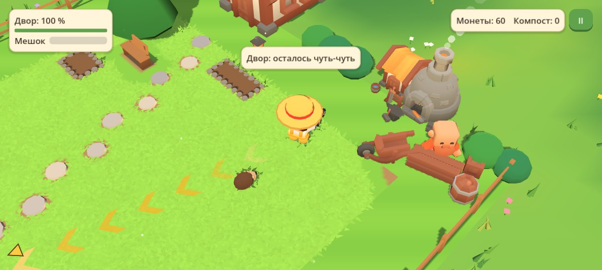
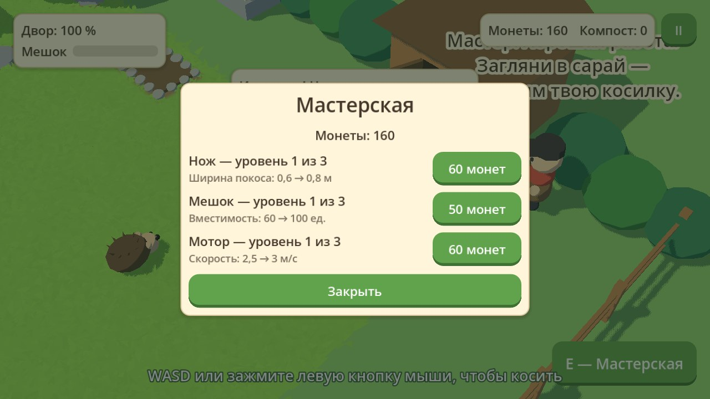
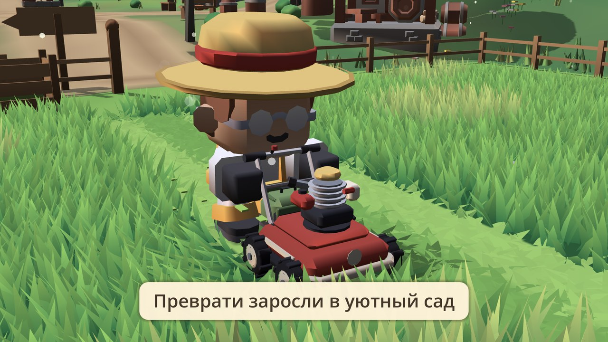

# Cozy-Game

Уютная игра про покос травы: выкашиваешь заросшую деревушку участок за участком и находишь то, что прячется в траве. Полное описание — в [GDD.md](GDD.md).



## Карта



Деревня — «звезда»: в середине поляна с колодцем и большим дубом, от неё к каждому участку идёт своя короткая дорога. С поляны видны все четыре калитки, от калитки до калитки — не больше трёх десятков шагов. Участки открываются по кругу: двор → сад бабушки → площадь → фруктовый сад, каждый на своей террасе. Вокруг поляны — таверна, рынок, дома, церковь; за деревней на холме — мельница.

Куда идти, игра показывает сама: когда участок выкошен, камера едет к калитке следующего и та распахивается на глазах; от игрока к ней ложится дорожка светящихся стрелок на земле, а стрелка у края экрана ведёт по той же дорожке.

| | |
|---|---|
|  |  |

Карта задаётся в `scripts/terrain.gd` (дороги и их высоты) и `scenes/village.tscn` (положение участков).

## Состояние

Готов этап **M3 — вся первая версия**: игра проходится от заросшего двора до праздника в деревне. Четыре участка, три жителя, мастерская, бюро находок, смена дней.

Покос:

- косилка режет траву и оставляет полосы; высокая трава замедляет; сквозь бурьян косилка едет медленно, а срезает его только нож второго уровня;
- мешок наполняется, полный мешок останавливает нож, траву высыпают в компостный ящик у калитки;
- с 90 % остатки травы подсвечивают светлячки, на 95 % участок засчитывается (облёт камеры, конфетти, награда, штампы);
- по мере покоса участок оживает: картинка становится ярче и теплее, чаще поют птицы.

Что прячется в траве:

- каменные дорожки, мощёная площадь, скамейки, колодец, фонтан и находки;
- зверьки — ёжик, спящий кот, лягушки: косилка в них упирается, их нужно перенести;
- камни: мешают косилке, убираются кнопкой;
- клумбы: за компост в них сажают цветы, над цветами летают бабочки.

Газон участка тянется до самого забора, а вокруг деревьев, скамеек и построек оставлена полоса без травы: вплотную к ним подлезать не нужно.

Деревня:

- участки стоят вокруг центральной поляны и открываются по очереди: двор → сад бабушки → площадь → фруктовый сад;
- в мастерской (её отпирает ключ, найденный во дворе) за монеты улучшают нож, мешок и мотор, по три уровня;
- жители возвращаются на выкошенные участки; чужие вещи из травы возвращают им через «Бюро находок» на площади;
- фонтан на площади чинится за монеты;
- у двери своего дома можно лечь спать: наступает новый день, на выкошенных участках отрастает короткая трава, и за повторный покос дают немного монет;
- когда выкошены все четыре участка, в деревне начинается праздник;
- прогресс сохраняется сам.

При запуске — титульный экран: камера кружит над деревней, кнопки «Играть» или «Продолжить» и «Новая игра». Когда открывается новый участок, над его калиткой крутится стрелка, пока игрок туда не зайдёт.

Отклик (juice): монетки и листики компоста вылетают из места награды и летят к счётчику, а он досчитывает; полоса прогресса участка звенит на 25, 50 и 75 %; персонаж пружинит на старте, оглядывается, когда стоит; из мотора идут облачка; упор в забор или дерево — мягкий «бум» с пылью; реплики жителей печатаются по буквам; в итогах участка штампы падают, как печати; камера чуть наезжает на находку.

| Площадь заросшая | Площадь выкошена, фонтан починен |
|---|---|
|  |  |



| Мастер у сарая | Мастерская |
|---|---|
|  |  |

Модели — из бесплатных наборов CC0 разных авторов: герой, жители и кот — Kenney, лягушка — Quaternius, постройки, деревья и бытовые мелочи — KayKit. Косилка и соломенная шляпа смоделированы для игры (`tools/make_models.py`). Из примитивов пока ёжик, забор, скамейки, клумбы и фонтан. Звуки временные, синтезированные скриптом; косилка беззвучна. Музыка — Kevin MacLeod, CC BY 4.0 (см. [CREDITS.md](CREDITS.md)).

## Запуск

1. Установите [Godot 4.8 beta 1](https://godotengine.org/download/archive/4.8-beta1/) (стандартная версия, не .NET).
2. Откройте в нём `project.godot`.
3. Нажмите F5.

## Управление

| Действие | Клавиатура и мышь | Геймпад | Тачскрин |
|---|---|---|---|
| Движение | WASD / стрелки или удержание левой кнопки мыши | Левый стик | Джойстик слева внизу (в паузе можно выбрать другой: под пальцем или «вести пальцем») |
| Действие (посадить цветы, починить фонтан, мастерская, бюро, сон) | E / пробел или кнопка на экране | A | Короткий тап по экрану или кнопка справа внизу |
| Масштаб | Колесо мыши | Бамперы | Щипок двумя пальцами |
| Пауза | Esc | Start | Кнопка справа вверху |

Трава в ящик высыпается сама, камни убираются сами, зверьки уходят сами — достаточно подъехать вплотную.

В меню паузы: звук, качество графики (на телефоне по умолчанию низкое), счётчик FPS, «Начать заново» (стирает прогресс). Внизу окна паузы есть строка диагностики: FPS, размер окна, безопасная область экрана, модель устройства и видеочип.

## Структура

```
scenes/          village.tscn (главная сцена), player.tscn, hud.tscn
scenes/plots/    участки: yard.tscn, garden.tscn, square.tscn, orchard.tscn
scripts/         логика на GDScript
shaders/         трава, земля, мультяшный свет
scenes/baked/    запечённое окружение деревни (делает tools/bake_map.gd)
assets/          модели, персонажи, звуки, музыка
tools/           запекание карты, свои модели, перевод моделей KayKit, звуки, трейлер
tests/           автопроверки
docs/            картинки для документации (Godot эту папку не импортирует)
```

Главное в `scripts/`:

| Файл | Что делает |
|---|---|
| `game_state.gd` | Автозагрузка `GameState`: монеты, компост, мешок, апгрейды, дни, флаги, сохранение |
| `village.gd`, `village_decor.gd` | Деревня: текущий участок, оживление цветом, праздник; улица и окружение |
| `plot.gd`, `plot_fence.gd` | Участок: завершение, награда, штампы, светлячки, открытие; забор с калиткой |
| `mow_field.gd`, `grass_zone.gd` | Поле травы и маска покоса; зоны бурьяна, высокой травы и мощения |
| `player.gd` | Персонаж с косилкой, ввод, взаимодействие, применение апгрейдов |
| `interactable.gd` | Основа для объектов с контекстной кнопкой (`compost_bin.gd`, `animal.gd`, `flower_bed.gd`, `stone.gd`, `repairable.gd`, `workshop.gd`, `bureau.gd`, `bedtime.gd`) |
| `find_item.gd` | Находка в траве |
| `guide_trail.gd`, `goal_pointer.gd` | Дорожка стрелок на земле к следующему участку; стрелка у края экрана |
| `touch_pad.gd` | Сенсорная схема «вести пальцем» |
| `flower_bed.gd`, `butterfly.gd` | Клумба, в которую сажают цветы за компост, и бабочки над ней |
| `villager.gd` | Житель: появляется после покоса участка, говорит реплики |
| `plot_prop.gd`, `stepping_stones.gd` | Дом, сарай, скамейка, дерево, колодец, фонтан, пруд; заросшая дорожка |
| `hud.gd` | Интерфейс: прогресс, мешок, ресурсы, реплики, мастерская, бюро находок, ночь, финал, пауза |
| `sfx.gd`, `juice.gd` | Звуки, музыка и вибрация; эффекты отклика |
| `terrain.gd`, `goal_pointer.gd` | Карта: сеть дорог с высотами, террасы участков, холмы; стрелка у края экрана к следующему участку |
| `models.gd`, `props_cluster.gd` | Модели с цветом в вершинах (KayKit и свои) и россыпи бытовых мелочей у построек |
| `character_model.gd` | Готовые персонажи и зверьки с анимациями (Kenney, Quaternius): материал игры, рост, тень |
| `map_bake.gd` | Запечённое окружение: где лежит и от чего зависит |
| `frame_probe.gd` | Замер кадра на устройстве: сколько стоит каждый слой картинки |
| `meadow.gd` | Луг вокруг участков: зоны травы, дорога с колеями, россыпи кочек, цветов, камней и грибов |
| `graphics.gd`, `shadows.gd` | Автозагрузка `Graphics`: качество, свет дня для всех материалов; тени предметов картинкой сверху |
| `placeholder.gd` | Временные модели из примитивов и их склейка в одну модель на объект |

Новый участок — это сцена с корнем `Plot`, внутри которой лежат `MowField`, `PlotFence` и объекты. Их можно двигать, копировать и настраивать в инспекторе: трава сама обходит объекты и прячет находки. Участок ставится в `village.tscn`; в поле `requires_plot` указывается, после какого участка он открывается. Участок можно развернуть на 180°, чтобы калитка смотрела на улицу с другой стороны.

## Карта запекается заранее

Землю, дороги, дома, деревья и россыпи луга игра не строит при запуске, а загружает готовыми из `scenes/baked/`. После правки карты (`scripts/terrain.gd`, `scripts/village_decor.gd`, `scripts/meadow.gd`, положение участков в `scenes/village.tscn`, модели в `assets/models/`) её нужно запечь заново:

```bash
godot --headless --path . --script tools/bake_map.gd
```

Проверка `tests/village.gd` упадёт, если запечённая карта старее правил, по которым она строится. Без файлов в `scenes/baked/` игра тоже работает: строит окружение при запуске, как раньше.

## Замер кадра на телефоне

В меню паузы есть кнопка «Замер кадра». За полминуты игра по очереди выключает слои картинки (трава, земля, дома и деревья, тени, сглаживание и др.) и показывает, на сколько миллисекунд каждый удешевляет кадр. Таблица копируется в буфер обмена. По ней видно, что именно тормозит на конкретном устройстве.

## Трейлер



[docs/trailer.mp4](docs/trailer.mp4) — 26 секунд геймплея (музыка — Kevin MacLeod, CC BY 4.0). Снимается самим движком по сценарию `tools/trailer.gd`:

```bash
tools/make_trailer.sh
```

## Проверки

```bash
godot --headless --path . --fixed-fps 60 --script tests/input.gd
```

```bash
godot --headless --path . --fixed-fps 60 --script tests/plot_cycle.gd
```

```bash
godot --headless --path . --fixed-fps 60 --script tests/village.gd
```

```bash
godot --headless --path . --fixed-fps 60 --script tests/late_game.gd
```

Все тесты стирают сохранение игры.
