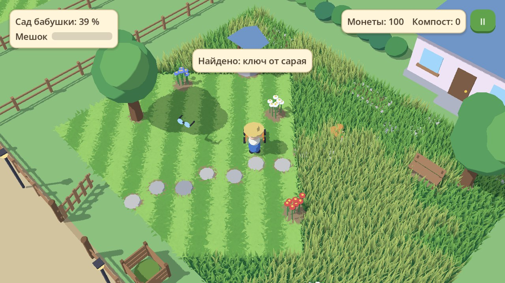

# Cozy-Game

Уютная игра про покос травы: выкашиваешь заросшую деревушку участок за участком и находишь то, что прячется в траве. Полное описание — в [GDD.md](GDD.md).



## Состояние

Готов этап **M2 — деревня и апгрейды**: замкнут цикл «покос → ресурсы → апгрейд → новый участок». В игре два участка (двор и сад бабушки), улица между ними и мастерская.

Покос:

- косилка режет траву и оставляет полосы, высокая трава замедляет;
- мешок наполняется, полный мешок останавливает нож, траву высыпают в компостный ящик у калитки;
- с 90 % остатки травы подсвечивают светлячки, на 95 % участок засчитывается (облёт камеры, конфетти, награда, штампы, в доме загораются окна);
- по мере покоса участок оживает: картинка становится ярче и теплее, чаще поют птицы.

Что прячется в траве:

- каменные дорожки, скамейки, колодец и находки (за некоторые дают монеты);
- зверьки — ёжик и спящий кот: косилка в них упирается, их нужно перенести;
- клумбы: за компост в них сажают цветы, над цветами летают бабочки;
- полевые цветы: скосить можно без штрафа, но за каждую сохранённую куртину в конце дают монеты.

Деревня:

- участки соединены улицей; калитка сада открывается, когда выкошен двор;
- ключ, найденный во дворе, отпирает сарай с мастерской, где за монеты улучшают нож (шире покос), мешок (больше вместимость) и мотор (выше скорость), по три уровня;
- жители возвращаются на выкошенные участки и говорят короткие реплики;
- прогресс сохраняется сам: после компоста, находок, посадки цветов, покупок, завершения участка и при закрытии игры.

| Мастер у сарая | Мастерская |
|---|---|
|  |  |

| Заросший двор | Выкошенный двор |
|---|---|
|  |  |

Модели временные, собраны из примитивов. Звуки тоже временные, синтезированные скриптом; музыки пока нет.

## Запуск

1. Установите [Godot 4.8 beta 1](https://godotengine.org/download/archive/4.8-beta1/) (стандартная версия, не .NET).
2. Откройте в нём `project.godot`.
3. Нажмите F5.

## Управление

| Действие | Клавиатура и мышь | Геймпад | Тачскрин |
|---|---|---|---|
| Движение | WASD / стрелки или удержание левой кнопки мыши | Левый стик | Коснуться экрана и тянуть |
| Действие (высыпать траву, перенести зверька, посадить цветы, мастерская) | E / пробел или кнопка на экране | A | Кнопка справа внизу |
| Масштаб | Колесо мыши | Бамперы | Щипок двумя пальцами |
| Пауза | Esc | Start | Кнопка справа вверху |

В меню паузы можно выключить звук и начать заново (стирает прогресс).

## Структура

```
scenes/          village.tscn (главная сцена), player.tscn, hud.tscn
scenes/plots/    участки: yard.tscn (двор), garden.tscn (сад бабушки)
scripts/         логика на GDScript
shaders/         трава, земля, мультяшный свет
assets/          звуки
tools/           вспомогательные скрипты (генератор временных звуков)
tests/           автопроверки
docs/            картинки для документации (Godot эту папку не импортирует)
```

Главное в `scripts/`:

| Файл | Что делает |
|---|---|
| `game_state.gd` | Автозагрузка `GameState`: монеты, компост, мешок, апгрейды, флаги, сохранение |
| `village.gd`, `village_decor.gd` | Деревня: текущий участок, оживление цветом, улица и окружение |
| `plot.gd`, `plot_fence.gd` | Участок: завершение, награда, штампы, светлячки, открытие; забор с калиткой |
| `mow_field.gd` | Поле травы и маска покоса |
| `player.gd` | Персонаж с косилкой, ввод, взаимодействие, применение апгрейдов |
| `interactable.gd` | Основа для объектов с контекстной кнопкой (`compost_bin.gd`, `animal.gd`, `flower_bed.gd`, `workshop.gd`) |
| `find_item.gd`, `wild_flowers.gd` | Находка в траве; куртина полевых цветов |
| `flower_bed.gd`, `butterfly.gd` | Клумба, в которую сажают цветы за компост, и бабочки над ней |
| `villager.gd` | Житель: появляется после покоса участка, говорит реплики |
| `plot_prop.gd`, `stepping_stones.gd` | Дом, сарай, скамейка, дерево, колодец; заросшая дорожка |
| `hud.gd` | Интерфейс: прогресс, мешок, ресурсы, реплики, мастерская, пауза |
| `sfx.gd`, `juice.gd` | Звуки и вибрация; эффекты отклика |
| `placeholder.gd` | Временные модели из примитивов |

Новый участок — это сцена с корнем `Plot`, внутри которой лежат `MowField`, `PlotFence` и объекты. Их можно двигать, копировать и настраивать в инспекторе: трава сама обходит объекты и прячет находки. Участок ставится в `village.tscn`; в поле `requires_plot` указывается, после какого участка он открывается.

## Проверки

```bash
godot --headless --path . --fixed-fps 60 --script tests/input.gd
```

```bash
godot --headless --path . --fixed-fps 60 --script tests/plot_cycle.gd
```

```bash
godot --headless --path . --fixed-fps 60 --script tests/village.gd
```

Все тесты стирают сохранение игры.
