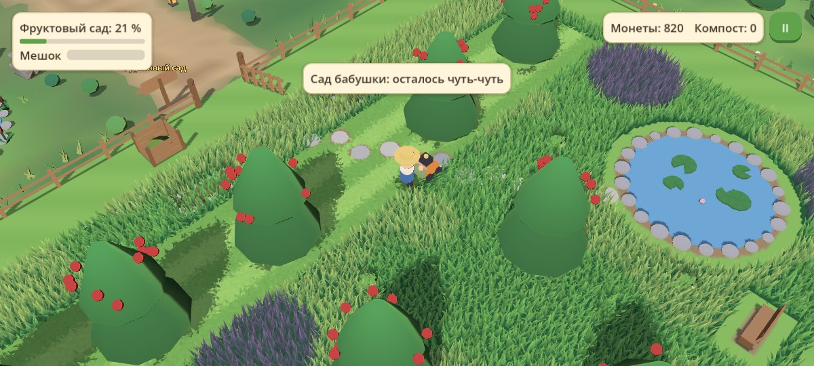
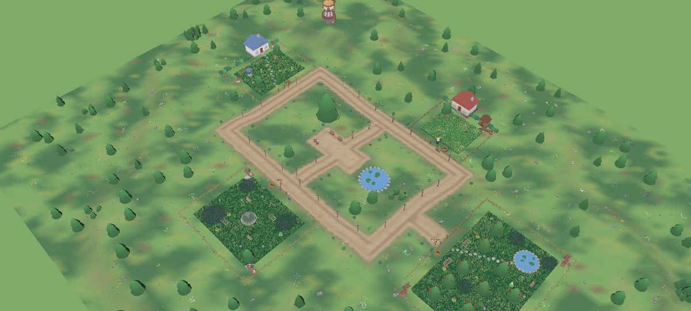
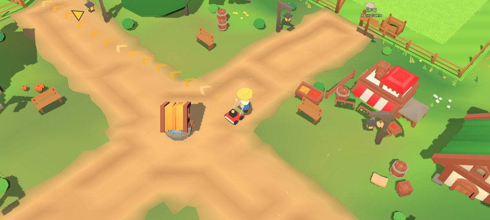
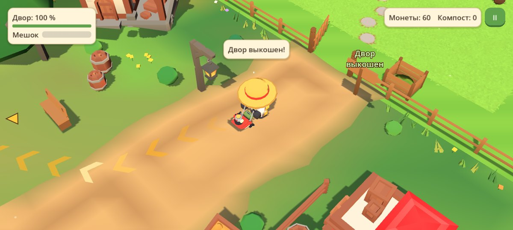
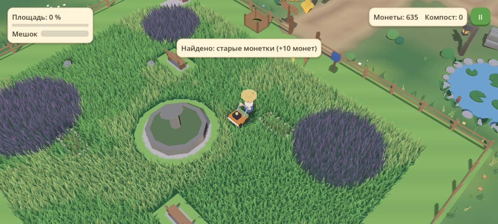
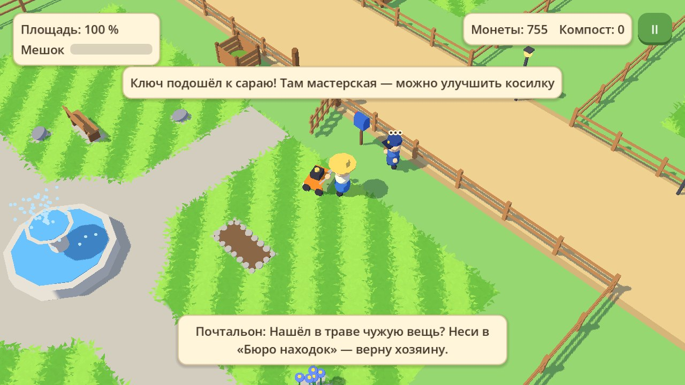
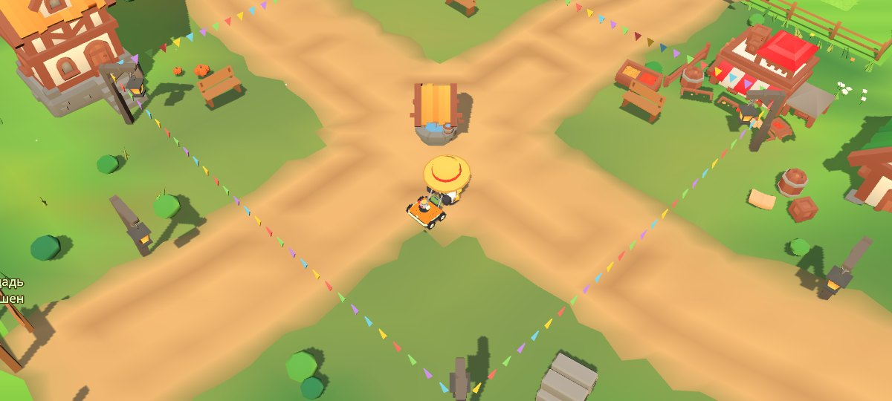
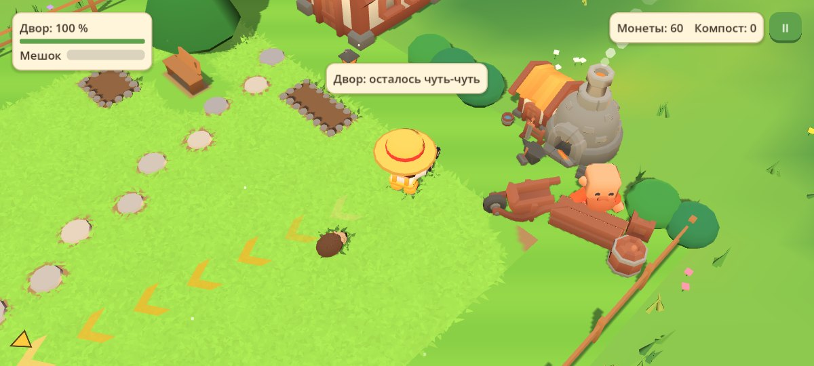
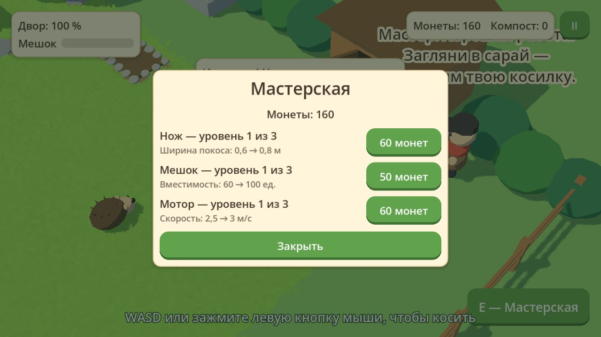
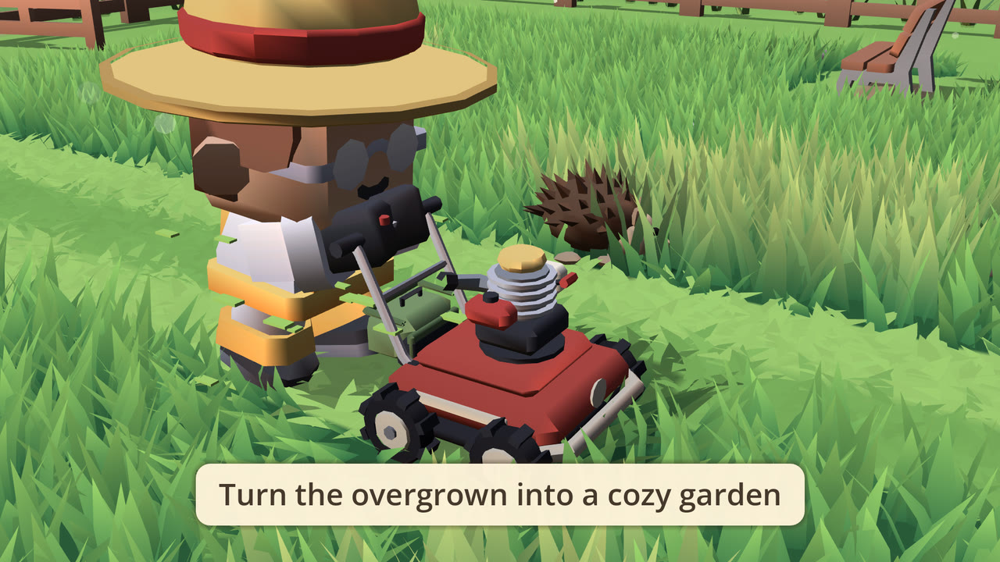

# Cozy Grass Cut

Уютная игра про покос травы: выкашиваешь заросшую деревушку участок за участком и находишь то, что прячется в траве. Полное описание — в [GDD.md](GDD.md).



## Карта



Деревня — «звезда»: в середине поляна с колодцем и большим дубом, от неё к каждому участку идёт своя короткая дорога. С поляны видны все четыре калитки, от калитки до калитки — не больше трёх десятков шагов. Участки открываются по кругу: двор → сад бабушки → площадь → фруктовый сад, каждый на своей террасе. Вокруг поляны — таверна, рынок, дома, церковь; за деревней на холме — мельница.

Куда идти, игра показывает сама: когда участок выкошен, камера едет к калитке следующего и та распахивается на глазах; от игрока к ней ложится дорожка светящихся стрелок на земле, а стрелка у края экрана ведёт по той же дорожке.

| | |
|---|---|
|  |  |

Карта задаётся в `scripts/terrain.gd` (дороги и их высоты) и `scenes/village.tscn` (положение участков).

## Состояние

Готов этап **M3 — вся первая версия**: игра проходится от заросшего двора до праздника в деревне. Четыре участка, три жителя, мастерская, бюро находок, смена дней.

Покос:

- косилка режет траву и оставляет полосы; высокая трава замедляет; сквозь бурьян косилка едет медленно, а срезает его только нож второго уровня;
- мешок наполняется, полный мешок останавливает нож, траву высыпают в компостный ящик у калитки;
- мелкие остатки травы убираются сами: узкие полоски между проходами и клочки рядом с косилкой срезаются без неё, выцеливать каждую травинку не нужно;
- на 80 % покоса открывается следующий участок (камера показывает его калитку), с 90 % остатки травы подсвечивают светлячки, на 95 % участок засчитывается (конфетти, награда, штампы), а облёт камеры — когда скошено всё, на 100 %;
- по мере покоса участок оживает: картинка становится ярче и теплее, чаще поют птицы, на выкошенный газон приходят цыплята (и удирают от косилки);
- из высокой травы выпрыгивают кузнечики, из бурьяна летит пух; когда участок выкошен, герой подпрыгивает от радости, а на празднике радуются жители и танцует кот.

Что прячется в траве:

- каменные дорожки, мощёная площадь, скамейки, колодец, фонтан и находки;
- зверьки — ёжик, спящий кот, лягушки: косилка в них упирается, их нужно перенести; ёжик убегает в свой уголок, перебирая лапками, кот бежит, лягушка прыгает;
- камни: мешают косилке, убираются кнопкой;
- клумбы: за компост в них сажают цветы, над цветами летают бабочки.

Газон участка тянется до самого забора, а вокруг деревьев, скамеек и построек оставлена полоса без травы: вплотную к ним подлезать не нужно.

Деревня:

- участки стоят вокруг центральной поляны и открываются по очереди: двор → сад бабушки → площадь → фруктовый сад; следующий открывается, когда текущий скошен на 80 %;
- в мастерской (её отпирает ключ, найденный во дворе; открывается вместе с возвращением Мастера, когда двор выкошен целиком) за монеты улучшают нож, мешок и мотор, по три уровня (у каждого свой значок, уровни — кружками);
- жители возвращаются на выкошенные участки; чужие вещи из травы возвращают им через «Бюро находок» на площади;
- фонтан на площади чинится за монеты;
- пока косишь, случаются события — у каждого участка свои, на 1:30, 3:00 и 5:00 (отсчёт свой, пока участок не выкошен; каждое один раз): во дворе — клевер-четырёхлистник, грибной дождик (трава мокнет и минуту блестит росой), воздушный шар с подарком; в саду бабушки — кот за бабочкой, пчёлы над клумбами, кролик с морковкой в траве; на площади — почтальон роняет письмо, голуби на газоне, радуга над фонтаном (когда его починят); во фруктовом саду — лягушачий хор у пруда, знакомый житель приходит посидеть на лавочке, яблокопад. Раз в 2–3 минуты — случайное: стая птиц, порыв ветра с листьями, а ещё дождик, кот, почтальон и яблокопад — после того как каждый уже был событием своего участка;
- у двери своего дома можно лечь спать: наступает новый день, на выкошенных участках отрастает короткая трава, и за повторный покос дают немного монет; пока спать можно (двор выкошен), у двери светится круг, а после праздника, когда закроют окно итогов, камера показывает дом и объясняет, что здесь можно спать;
- когда выкошены все четыре участка, в деревне начинается праздник;
- прогресс сохраняется сам.

При запуске — титульный экран: камера кружит над деревней, кнопки «Играть» или «Продолжить» и «Новая игра». Когда открывается новый участок, у его калитки на земле светится круг, пока игрок туда не зайдёт; такой же круг — вокруг компостного ящика, когда мешок полон.

Отклик (juice): монетки и листики компоста вылетают из места награды и летят к счётчику, а он досчитывает; полоса прогресса участка звенит на 25, 50 и 75 %; персонаж пружинит на старте, а мотор «чихает» облачком; из мотора идут облачка; герой поворачивает голову к находке и к зверьку рядом, а постояв, оглядывается; упор в забор или дерево — мягкий «бум» с пылью, дерево качается и роняет листья, скамейка вздрагивает; трава из мешка летит в компостный ящик комочками, и он отзывается, когда она долетела; спрятанная рядом вещь поблёскивает над травой; из бурьяна летят лиловые обрезки; реплики жителей печатаются по буквам; в итогах участка штампы падают, как печати; камера чуть наезжает на находку.

| Площадь заросшая | Площадь выкошена, фонтан починен |
|---|---|
|  |  |



| Мастер у сарая | Мастерская |
|---|---|
|  |  |

Модели — из бесплатных наборов CC0 разных авторов: герой, жители и кот — Kenney, лягушка — Quaternius, постройки, деревья и бытовые мелочи — KayKit. Забор, указатели, ключ, монеты, цветы на клумбах — тоже Kenney (Fantasy Town Kit, Platformer Kit). Косилка, соломенная шляпа, ёжик, остальные находки, почтовый ящик, компостный ящик, кусты, плитки, кочки и полевые цветы смоделированы для игры (`tools/make_models.py`). Звуки — Kenney (CC0), мелодичные синтезированы скриптом; косилка беззвучна. Музыка — Kevin MacLeod, CC BY 4.0 (см. [CREDITS.md](CREDITS.md)).

## Запуск

1. Установите [Godot 4.8 beta 1](https://godotengine.org/download/archive/4.8-beta1/) (стандартная версия, не .NET).
2. Откройте в нём `project.godot`.
3. Нажмите F5.

## Управление

| Действие | Клавиатура и мышь | Геймпад | Тачскрин |
|---|---|---|---|
| Движение | WASD / стрелки или удержание левой кнопки мыши | Левый стик | С камерой сверху — джойстик появляется под пальцем в левом нижнем углу и ведёт по карте (в паузе можно выбрать другой: везде под пальцем или «вести пальцем»). С камерой сзади — руль: джойстик появляется под пальцем в левом нижнем углу, влево-вправо поворачивает героя, вверх — вперёд, вниз — задний ход |
| Действие (посадить цветы, починить фонтан, мастерская, бюро, сон) | E / пробел или кнопка на экране | A | Короткий тап по экрану или кнопка справа внизу |
| Масштаб | Колесо мыши | Бамперы | Щипок двумя пальцами |
| Пауза | Esc | Start | Кнопка справа вверху |
| Камера сверху / сзади | C | Back | Кнопка с фотоаппаратом справа вверху |

Трава в ящик высыпается сама, камни убираются сами, зверьки уходят сами — достаточно подъехать вплотную.

Языки (10): English, русский, українська, español, português (Brasil), Deutsch, français, italiano, polski, Türkçe. При первом запуске язык берётся с устройства (если его нет в игре — английский; для белорусского и казахского — русский). Кнопка с глобусом на титульном экране и «Язык» в меню паузы открывают окно выбора: все языки сразу, каждый подписан на самом себе, выбранный отмечен галочкой; нажатие мимо окна или Esc закрывает его. Китайского, японского и корейского пока нет: им нужен свой шрифт на несколько мегабайт.

В меню паузы: «Продолжить», звуки, музыка, качество графики (на телефоне по умолчанию низкое), счётчик FPS, управление (только на сенсорном экране), язык, «Выйти из игры» (только на компьютере). У каждой кнопки свой значок; выключенное — светлая кнопка, у звука и музыки значок перечёркнут. Со счётчиком FPS внизу окна паузы видна строка диагностики: размер окна, безопасная область экрана, модель устройства и видеочип. Камера (сверху или сзади, за спиной героя) переключается кнопкой справа вверху рядом с паузой; на компьютере под кнопками подписаны клавиши (C, Esc). Нажатие мимо открытого окна (пауза, мастерская, бюро находок, итоги участка) закрывает его; титульный экран так не закрывается.

## Структура

```
scenes/          village.tscn (главная сцена), player.tscn, hud.tscn
scenes/plots/    участки: yard.tscn, garden.tscn, square.tscn, orchard.tscn
scripts/         логика на GDScript
shaders/         трава, земля, мультяшный свет
scenes/baked/    запечённое окружение деревни (делает tools/bake_map.gd)
assets/          модели, персонажи, звуки, музыка
tools/           запекание карты, свои модели, перевод моделей KayKit, звуки, трейлер
tests/           автопроверки
docs/            картинки для документации (Godot эту папку не импортирует)
```

Главное в `scripts/`:

| Файл | Что делает |
|---|---|
| `game_state.gd` | Автозагрузка `GameState`: монеты, компост, мешок, апгрейды, дни, флаги, сохранение |
| `village.gd`, `village_decor.gd` | Деревня: текущий участок, оживление цветом, праздник; улица и окружение |
| `plot.gd`, `plot_fence.gd` | Участок: завершение, награда, штампы, светлячки, открытие; забор с калиткой |
| `mow_field.gd`, `grass_zone.gd` | Поле травы и маска покоса; зоны бурьяна, высокой травы и мощения |
| `player.gd` | Персонаж с косилкой, ввод, взаимодействие, применение апгрейдов |
| `interactable.gd` | Основа для объектов с контекстной кнопкой (`compost_bin.gd`, `animal.gd`, `flower_bed.gd`, `stone.gd`, `repairable.gd`, `workshop.gd`, `bureau.gd`, `bedtime.gd`) |
| `find_item.gd` | Находка в траве |
| `guide_trail.gd`, `goal_pointer.gd` | Дорожка стрелок на земле к следующему участку; стрелка у края экрана |
| `touch_pad.gd` | Сенсорная схема «вести пальцем» |
| `flower_bed.gd`, `butterfly.gd` | Клумба, в которую сажают цветы за компост, и бабочки над ней |
| `villager.gd` | Житель: появляется после покоса участка, говорит реплики |
| `plot_prop.gd`, `stepping_stones.gd` | Дом, сарай, скамейка, дерево, колодец, фонтан, пруд; заросшая дорожка |
| `plot_events.gd`, `event_*.gd` | События: по времени на участке (письмо, дождик, воздушный шар) и случайные (клевер, кот за бабочкой, птицы, ветер); подарки событий |
| `hud.gd` | Интерфейс: прогресс, мешок, ресурсы, реплики, мастерская, бюро находок, ночь, финал, пауза |
| `hud_icon.gd`, `icon_studio.gd` | Значки интерфейса: мешок, компост (ящик с травой) и мотор сняты с моделей игры один раз за запуск; монета, нож, значки кнопок и кружки уровня нарисованы фигурами |
| `sfx.gd`, `juice.gd` | Звуки, музыка и вибрация; эффекты отклика |
| `terrain.gd`, `goal_pointer.gd` | Карта: сеть дорог с высотами, террасы участков, холмы; стрелка у края экрана к следующему участку |
| `models.gd`, `props_cluster.gd` | Модели с цветом в вершинах (KayKit и свои) и россыпи бытовых мелочей у построек |
| `character_model.gd` | Готовые персонажи и зверьки с анимациями (Kenney, Quaternius): материал игры, рост, тень |
| `map_bake.gd` | Запечённое окружение: где лежит и от чего зависит |
| `l.gd`, `strings_en.gd` | Перевод: `L.t("строка")` и словарь английского. Тексты в коде и сценах пишутся по-русски; проверка `tests/input.gd` упадёт, если у строки нет перевода |
| `meadow.gd` | Луг вокруг участков: зоны травы, дорога с колеями, россыпи кочек, цветов, камней и грибов |
| `graphics.gd`, `shadows.gd` | Автозагрузка `Graphics`: качество, свет дня для всех материалов; тени предметов картинкой сверху |
| `placeholder.gd` | Временные модели из примитивов и их склейка в одну модель на объект |

Новый участок — это сцена с корнем `Plot`, внутри которой лежат `MowField`, `PlotFence` и объекты. Их можно двигать, копировать и настраивать в инспекторе: трава сама обходит объекты и прячет находки. Участок ставится в `village.tscn`; в поле `requires_plot` указывается, после какого участка он открывается. Участок можно развернуть на 180°, чтобы калитка смотрела на улицу с другой стороны.

## Карта запекается заранее

Землю, дороги, дома, деревья и россыпи луга игра не строит при запуске, а загружает готовыми из `scenes/baked/`. После правки карты (`scripts/terrain.gd`, `scripts/village_decor.gd`, `scripts/meadow.gd`, положение участков в `scenes/village.tscn`, модели в `assets/models/`) её нужно запечь заново:

```bash
godot --headless --path . --script tools/bake_map.gd
```

Проверка `tests/village.gd` упадёт, если запечённая карта старее правил, по которым она строится. Без файлов в `scenes/baked/` игра тоже работает: строит окружение при запуске, как раньше.

## Трейлер



[docs/trailer.mp4](docs/trailer.mp4) — 34 секунды геймплея на английском (музыка — «Wholesome», Kevin MacLeod, CC BY 4.0). Монтаж идёт по музыке: трек чуть ускорен (127,85 → 128,6 удара в минуту), чтобы доля длилась ровно 14 кадров; смены кадра стоят на границах тактов, подписи, прыжки ёжика, находки, калитка, залпы и название — на долях, шаги героя — в том же темпе. Звуков немного и тихо, под музыкой: ёжик, две находки и мелодия «двор выкошен». Снимается самим движком по сценарию `tools/trailer.gd` (с `TRAILER_PREVIEW=<папка>` — быстрый прогон с кадрами-картинками вместо записи):

```bash
tools/make_trailer.sh
```

## Проверки

```bash
godot --headless --path . --fixed-fps 60 --script tests/input.gd
```

```bash
godot --headless --path . --fixed-fps 60 --script tests/plot_cycle.gd
```

```bash
godot --headless --path . --fixed-fps 60 --script tests/village.gd
```

```bash
godot --headless --path . --fixed-fps 60 --script tests/late_game.gd
```

```bash
godot --headless --path . --fixed-fps 60 --script tests/events.gd
```

Все тесты стирают сохранение игры.
